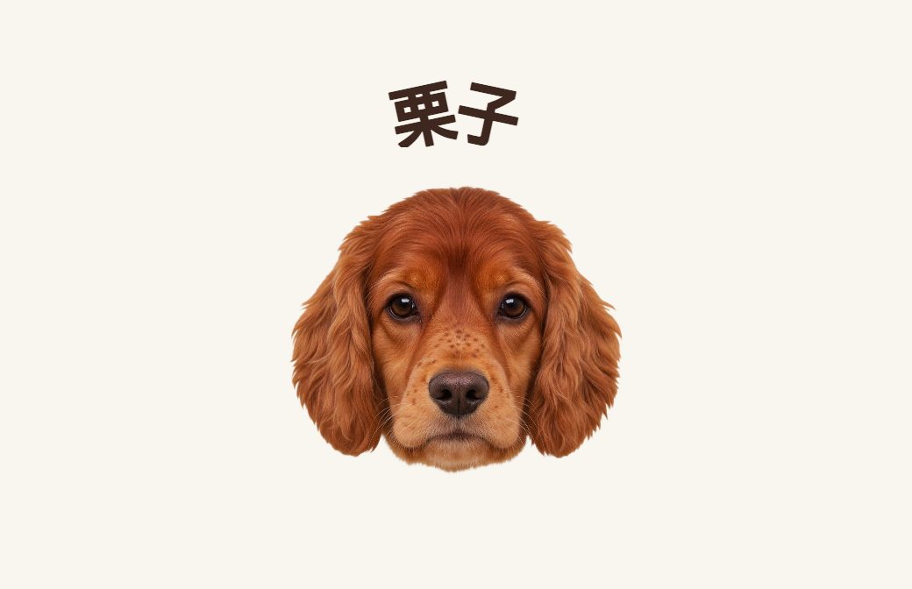
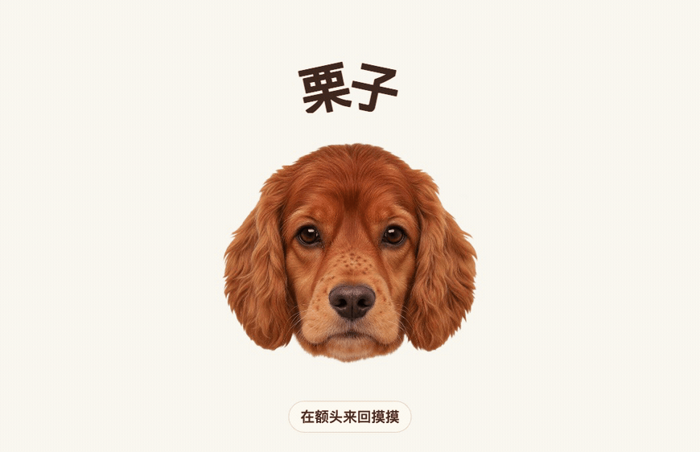

# 旺仔 · 宠物互动头像

旺仔把宠物照片变成一只可以摸、可以捏、也会用表情回应的网页头像。它适合想把宠物照片做成互动纪念的主人，也适合想给宠物内容做一张动态分享卡的创作者。

## 为什么做旺仔

我想把平时伸手摸摸宠物、逗它一下的感觉做进网页。访客打开页面就能直接和头像互动，玩过之后还能保存表情海报或短片，分享给朋友。

## 能做什么

- **看过来。** 在电脑上移动鼠标，或在手机上移动触点，宠物的视线会跟着走。
- **摸摸它。** 在头部小幅来回抚摸，它会闭眼微笑、轻轻摆头。连点两下可以逗它大笑。
- **捏一下。** 按住脸颊或耳朵轻轻拉开，松手后会泛红、回弹。
- **保存分享。** 点头像上方的名字，可以试听或关闭音效，也可以保存表情海报和动态短片。

## 从摸摸到回弹

演示用的是虚构宠物「栗子」。先在额头小幅来回移动，等栗子闭眼微笑。接着按住脸颊向外拖动，再松开，看看它怎么弹回原位。

电脑上抚摸时直接来回移动鼠标，拉扯时按住鼠标即可。手机上用手指小幅往返抚摸，或沿同一方向拉动。
